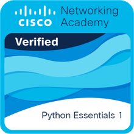

### Stanisław Abucewicz

**Applied Computer Science @ Uniwersytet DSW Ideis Kraków** · Cybersecurity, SOC & Systems

---

### Verified Credentials

<table>
  <tr>
    <td width="135" align="center">
      
    </td>
    <td>
      <strong><a href="https://www.credly.com/badges/d611b17a-21c0-4492-a619-e31a1013ee33/public_url">Python Essentials 1 — Cisco Networking Academy</a></strong> 
      Issued by <strong>Cisco</strong> (in collaboration with OpenEDG Python Institute) · November 2026 
      Core Python syntax, semantics, standard library, debugging, and algorithmic problem solving.  
      <a href="https://www.credly.com/badges/d611b17a-21c0-4492-a619-e31a1013ee33/public_url">Verify credential on Credly →</a>
    </td>
  </tr>
</table>

- **In Progress:** Cisco Networking Academy — *Computer Networks*
- **Award:** Ogólnopolski Konkurs Programistyczny *Gigathon* — 2nd Stage Qualifier (May 2024)

---

### Focus & Core Stack

- **Systems & Security:** Linux (`Kali`, `WSL2`), Windows, LAN fundamentals, Bash, PowerShell, TryHackMe, Hack The Box, CTF & AGH Cyber Campus 4
- **Engineering & Backend:** Python, Node.js, JavaScript / TypeScript, SQL, Firebase (`Auth`, `Firestore RBAC`), Git
- **Experience:** IT, Computer Science & Mathematics Tutor (`Oct 2025 – Present`, prepping students for INF.02/INF.03)

---

### Selected Projects

| Project | Stack & Highlights | Status |
| :--- | :--- | :--- |
| [**TutedoFlow**](https://tutedoflow.pl) *(Private repo)* | Full-stack SaaS PWA for tutors & students — Node.js (`>=20`), native ESM, Firestore RBAC rules, server-side grading, HMAC Stripe webhooks, WebRTC whiteboard, 163 tests | In Progress |
| [**CzasoPłaca**](https://github.com/sabucewicz/czasoplaca) | Responsive PWA for live work-hour & earnings tracking with 5-week `localStorage` archive (`React`, `TypeScript`, `Vite`, `Tailwind`) | Public |
| [**Kawonia Website**](https://github.com/sabucewicz/coffehouse_web) | Multi-page static site for a local coffee & flower shop (`HTML`, `CSS`, `vanilla JS`, SEO) | In Progress |
| [**Wydatki Miesięczne**](https://github.com/sabucewicz/wydatki_app) | Lightweight mobile-first PWA for monthly category budget tracking (`HTML`, `CSS`, `JS`, cookies) | Public |
| [**Custom Couple Dashboard**](https://github.com/sabucewicz/our_app_demo) | Cross-platform mobile app demo (`Flutter`, `Dart`, Firebase Firestore architecture) | Public |
